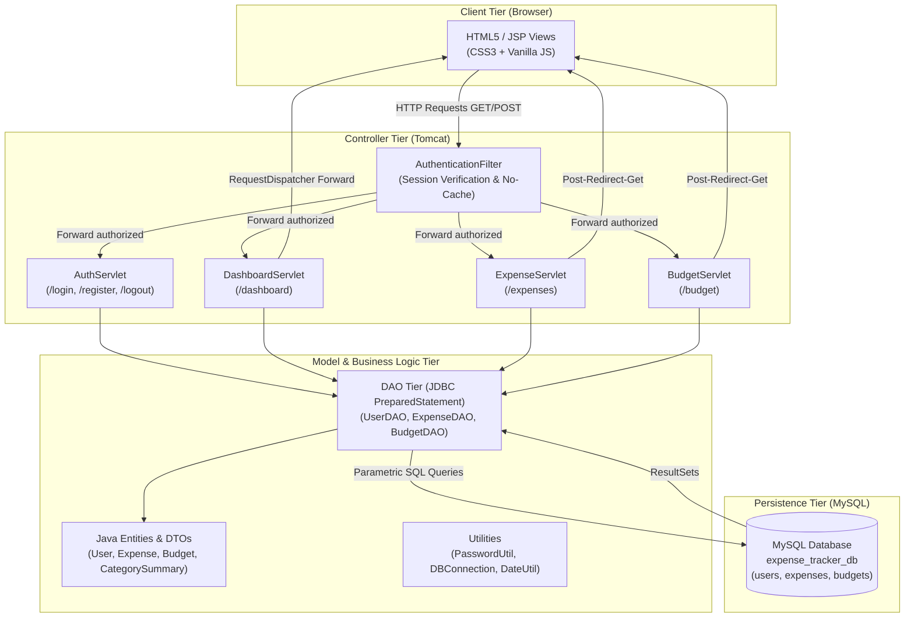
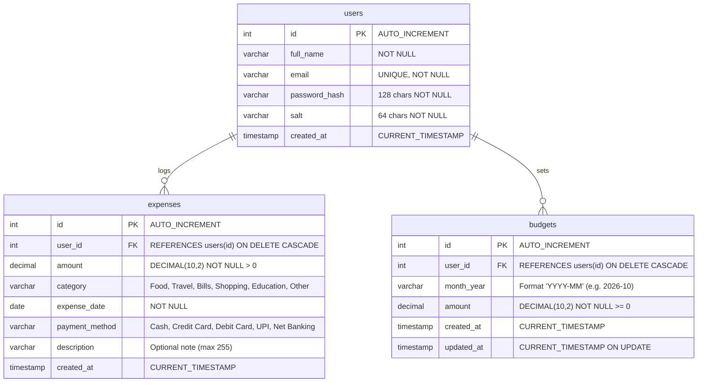

# Smart Expense Tracker

> **Academic Mini Project**  
> **Course:** Advanced Internet Programming  
> **Technology Stack:** Java Servlets, JSP, JDBC (PreparedStatement), MySQL, Apache Tomcat, HttpSession, HTML5/CSS3.  
> **Architecture:** Standard Model-View-Controller (MVC) with Data Access Object (DAO) pattern.

---

## 1. Project Overview

**Smart Expense Tracker** is a complete, secure, and responsive web application designed for personal finance management. It allows registered users to log daily expenses across multiple categories, configure monthly spending budgets, track budget utilization in real-time, and view insightful category-wise spending analytics.

The application strictly implements the curriculum specifications for **Advanced Internet Programming**:
- **No Node.js, Express, PHP, or JavaScript backend frameworks**.
- Pure **Java Servlets** for server-side business logic and routing.
- **JavaServer Pages (JSP)** with Expression Language (EL) and JSTL for presentation.
- **JDBC with `PreparedStatement`** for all database queries to prevent SQL Injection.
- **`HttpSession`** for stateful user authentication and access control.
- **Apache Tomcat** web server deployment.

---

## 2. System Architecture & Design Pattern

The application strictly adheres to the standard Java Enterprise **Model-View-Controller (MVC)** and **Data Access Object (DAO)** architectural patterns:



### Architectural Separation:
1. **Model Layer (`com.expensetracker.model`)**:
   - `User`: Encapsulates user profile, email, salt, and salted password hash.
   - `Expense`: Represents financial transactions (amount, category, date, payment method, description).
   - `Budget`: Represents monthly spending targets per user.
   - `CategorySummary` & `MonthlySummary`: Aggregation DTOs for dashboard analytics.

2. **Data Access Layer (`com.expensetracker.dao`)**:
   - `UserDAO`: User registration, email uniqueness checks, and credential lookups.
   - `ExpenseDAO`: User-isolated expense CRUD, dynamic filtering, category totals, and history.
   - `BudgetDAO`: Monthly budget configuration using SQL `ON DUPLICATE KEY UPDATE` (UPSERT).

3. **Controller Layer (`com.expensetracker.servlet` & `filter`)**:
   - `AuthenticationFilter`: Intercepts protected requests, verifies `session.getAttribute("user")`, and sets HTTP cache-prevention headers.
   - `AuthServlet`: Handles registration validation, password hashing, login verification, and session invalidation.
   - `DashboardServlet`: Gathers monthly totals, calculates budget consumption %, and determines alert states.
   - `ExpenseServlet`: Implements Post-Redirect-Get (PRG) pattern for adding, editing, and deleting expenses.
   - `BudgetServlet`: Manages monthly budget limits and enforces unique user-month constraints.

4. **View Layer (`src/main/webapp/WEB-INF/views/`)**:
   - JSP pages rendered strictly server-side.
   - Includes modular templates: `header.jsp`, `footer.jsp`, and `alerts.jsp`.
   - All protected JSPs reside inside `/WEB-INF/views/` preventing direct browser URL access.

---

## 3. Database Schema

The database design uses InnoDB engine with foreign keys, cascading deletes, unique constraints, and check constraints.



### Key Relational Rules:
- **Tenant Isolation**: Every `expenses` and `budgets` query includes `WHERE user_id = ?` to strictly guarantee that users can never access or modify records belonging to others.
- **Unique Monthly Budget**: Constraint `UNIQUE (user_id, month_year)` guarantees that each user has exactly one budget allocation per calendar month.
- **Referential Integrity**: Cascading delete (`ON DELETE CASCADE`) ensures that if a user account is removed, all associated expenses and budgets are purged cleanly.

---

## 4. Key Functional Features

### 1. User Registration & Authentication
- Input sanitization and server-side validation (email regex, password length >= 6, match validation).
- **Cryptographic Security**: Passwords are saved with a cryptographically generated 16-byte random salt and SHA-256 hashing via `PasswordUtil.java`.
- **Session Management**: Session fixation protection via session replacement on login; 30-minute timeout configured in `web.xml`.
- **Cache Invalidation**: Prevents browser back-button history access to private expense data after logout using `Cache-Control: no-cache, no-store, must-revalidate`.

### 2. Expense Management (Full CRUD)
- **Add Expense**: Record amount, category (`Food`, `Travel`, `Bills`, `Shopping`, `Education`, `Other`), date, payment method (`Cash`, `Credit Card`, `Debit Card`, `UPI`, `Net Banking`), and optional notes.
- **Filter & Search**: Filter by Month (`YYYY-MM`), Category, and search by keywords in descriptions or payment methods.
- **Multi-criteria Sorting**: Sort by date (descending/ascending) or amount (highest/lowest).
- **Edit & Delete**: Pre-populated edit form; deletions confirmed via dialog and executed via `POST` for idempotency and security.

### 3. Monthly Budget & Proactive Warnings
- Set or update a spending target for any month (`YYYY-MM`).
- Calculates:
  $$\text{Remaining Balance} = \text{Budget Amount} - \text{Total Expenses}$$
  $$\text{Utilization Percentage} = \left(\frac{\text{Total Expenses}}{\text{Budget Amount}}\right) \times 100$$
- **Three-tier Status Warnings**:
  - **Normal (`< 80%`)**: Green progress meter indicating healthy spending.
  - **Warning (`80% - 100%`)**: Amber warning alert banner warning that the 80% threshold has been breached.
  - **Danger (`> 100%`)**: Red alert banner highlighting that the budget has been exceeded, showing the exact overrun amount.

### 4. Interactive Dashboard
- 4 real-time metric cards: Total Spent, Monthly Budget, Remaining Balance, and Transaction Count.
- Category distribution table with visual percentage progress meters.
- Past 6-month expenditure history comparison.
- Recent 5 transactions table with quick actions.
- Sensible empty-state placeholders when no records exist.

---

## 5. Project Directory Structure

```
Smart Expense Tracker/
├── pom.xml                               # Maven project descriptor
├── build.bat                             # One-click Windows build script
├── README.md                             # Comprehensive project documentation
├── database/
│   ├── schema.sql                        # DDL table creation and constraints
│   └── sample_data.sql                   # Pre-seeded users, budgets, and expenses
└── src/
    └── main/
        ├── java/
        │   └── com/
        │       └── expensetracker/
        │           ├── dao/              # Database Access Objects (PreparedStatement)
        │           │   ├── BudgetDAO.java
        │           │   ├── ExpenseDAO.java
        │           │   └── UserDAO.java
        │           ├── filter/           # Security and Session Filter
        │           │   └── AuthenticationFilter.java
        │           ├── model/            # Entities and Summary DTOs
        │           │   ├── Budget.java
        │           │   ├── CategorySummary.java
        │           │   ├── Expense.java
        │           │   ├── MonthlySummary.java
        │           │   └── User.java
        │           ├── servlet/          # Controller Servlets
        │           │   ├── AuthServlet.java
        │           │   ├── BudgetServlet.java
        │           │   ├── DashboardServlet.java
        │           │   └── ExpenseServlet.java
        │           └── util/             # Helper Utilities
        │               ├── DBConnection.java
        │               ├── DateUtil.java
        │               └── PasswordUtil.java
        ├── resources/
        │   └── db.properties             # Database credentials & URL configuration
        └── webapp/
            ├── index.jsp                 # Landing page
            ├── assets/
            │   ├── css/
            │   │   └── style.css         # Modern, responsive CSS (100% offline ready)
            │   └── js/
            │       └── main.js           # Client-side validations & helpers
            └── WEB-INF/
                ├── web.xml               # Servlet 4.0 Deployment Descriptor
                ├── lib/                  # Bundled runtime libraries (mysql, jstl)
                │   ├── jstl-1.2.jar
                │   └── mysql-connector-j-8.3.0.jar
                └── views/                # Protected JSP View Templates
                    ├── auth/
                    │   ├── login.jsp
                    │   └── register.jsp
                    ├── budget/
                    │   └── budget.jsp
                    ├── common/
                    │   ├── alerts.jsp
                    │   ├── footer.jsp
                    │   └── header.jsp
                    ├── error/
                    │   ├── 404.jsp
                    │   └── 500.jsp
                    ├── expenses/
                    │   ├── form.jsp
                    │   └── list.jsp
                    └── dashboard.jsp
```

---

## 6. Setup and Installation Guide

### Prerequisites
1. **Java Development Kit (JDK)**: JDK 11, 17, or 21+.
2. **Database**: MySQL Server 5.7+ or 8.0+ (running on default port `3306`).
3. **Web Server**: Apache Tomcat 8.5 or 9.0 (Tomcat 10+ supported via Jakarta namespace or migration tool).
4. **Build Tool (Optional)**: Apache Maven 3.6+ (or use the included `build.bat`).

---

### Step 1: Database Setup
1. Start your MySQL service (e.g. via MySQL Command Line, MySQL Workbench, or XAMPP).
2. Execute the schema script:
   ```bash
   mysql -u root -p < database/schema.sql
   ```
3. Load the sample evaluation data:
   ```bash
   mysql -u root -p < database/sample_data.sql
   ```

### Step 2: Database Connection Configuration
Open `src/main/resources/db.properties` (and `src/main/webapp/WEB-INF/classes/db.properties` if running exploded):
```properties
db.driver=com.mysql.cj.jdbc.Driver
db.url=jdbc:mysql://localhost:3306/expense_tracker_db?useSSL=false&allowPublicKeyRetrieval=true&serverTimezone=UTC&useUnicode=true&characterEncoding=UTF-8
db.username=root
db.password=root
```
> **Note**: Update `db.username` and `db.password` to match your local MySQL credentials.

---

### Step 3: Build & Deployment

#### Option A: One-Click Build (`build.bat`)
Double-click `build.bat` in the project root (or run it from CMD):
- If Maven is installed, it executes `mvn clean package`.
- If Maven is not installed, it compiles directly with `javac` and packages `target\smart-expense-tracker.war`.
- Copy `target\smart-expense-tracker.war` to your Tomcat `webapps/` folder.

#### Option B: Using Maven CLI
```bash
mvn clean package
```
This produces `target/smart-expense-tracker.war`. Copy it to `$CATALINA_HOME/webapps/`.

#### Option C: In Eclipse IDE (Enterprise Java and Web Developers)
1. Open Eclipse -> **File** -> **Import...** -> **Existing Maven Projects**.
2. Select the `Smart Expense Tracker` folder and click **Finish**.
3. Right-click the project -> **Run As** -> **Run on Server** -> Select **Apache Tomcat v9.0**.

#### Option D: In IntelliJ IDEA (Ultimate)
1. Open IntelliJ -> **File** -> **Open** -> Select `pom.xml`.
2. Configure Tomcat Server under **Run/Debug Configurations**.
3. Add `smart-expense-tracker:war exploded` as deployment artifact and click **Run**.

---

### Step 4: Access the Application
Open your web browser and navigate to:
```
http://localhost:8080/smart-expense-tracker/
```

---

## 7. Pre-configured Demo Accounts

The `database/sample_data.sql` script creates pre-seeded accounts for immediate evaluation:

| User Name | Email Address | Password | Preloaded Features |
| :--- | :--- | :--- | :--- |
| **John Doe** | `john@example.com` | `Password123` | **Current Month Budget**: ₹25,000<br>**Spent**: ~₹20,850 (~83.4%)<br>Triggers the **80% Warning Banner** automatically! |
| **Alice Smith**| `demo@tracker.com` | `Demo@123` | Normal spending, multiple expense categories. |

---

## 8. Important Servlets & Technical Reference

| Servlet Name | URL Patterns | HTTP Methods | Responsibility |
| :--- | :--- | :--- | :--- |
| `AuthServlet` | `/login`, `/register`, `/logout` | `GET`, `POST` | Manages login verification, registration validation, password hashing, and session destruction. |
| `DashboardServlet` | `/dashboard` | `GET` | Computes monthly spendings, budget balance, threshold alerts, and category summaries. |
| `ExpenseServlet` | `/expenses` | `GET`, `POST` | Implements CRUD: `list` (with filter/search), `new`, `edit`, `insert`, `update`, and `delete`. |
| `BudgetServlet` | `/budget` | `GET`, `POST` | Handles monthly budget configuration, updates, history, and status monitoring. |
| `AuthenticationFilter` | `/*` | All | Enforces login access control, session validation, and no-cache security headers. |

---

## 9. Academic Mini-Project Viva Q&A

### Q1: Why did you use `PreparedStatement` instead of `Statement`?
> **Answer**: `PreparedStatement` pre-compiles the SQL query template on the database server. Dynamic parameters are bound separately using placeholders (`?`), which ensures user inputs are never interpreted as executable SQL syntax. This eliminates the risk of **SQL Injection (SQLi)** attacks and also improves query execution performance through query plan reuse.

### Q2: How is session tracking maintained across pages?
> **Answer**: Through `HttpSession`. When a user successfully authenticates in `AuthServlet`, a session is created using `request.getSession(true)` and the `User` object is stored as a session attribute (`session.setAttribute("user", user)`). The `AuthenticationFilter` intercepts incoming requests and verifies whether an active session containing a valid user exists before granting access to protected views.

### Q3: Why is password hashing with salt necessary?
> **Answer**: Storing plaintext passwords exposes user accounts to severe risks if the database is compromised. We use SHA-256 with a unique 16-byte random salt generated by `SecureRandom` per user (`salt + password`). The salt prevents attacks using precomputed lookup tables (Rainbow Table attacks), ensuring two users with identical passwords have completely different hashes.

### Q4: Why use the Post-Redirect-Get (PRG) pattern?
> **Answer**: In `ExpenseServlet` and `BudgetServlet`, when a user submits a form via `POST`, the server updates the database and issues an HTTP 302 redirect (`response.sendRedirect(...)`) rather than forwarding. This prevents accidental duplicate form submissions if the user refreshes the page or clicks the browser back button.

---

## 10. Known Limitations & Future Enhancements

- **Currency Localization**: Currently formatted for Indian Rupee (`₹`); can be extended with multi-currency selector and real-time exchange rates.
- **Exporting Reports**: Can be enhanced with Apache POI to export monthly spending statements as Excel (`.xlsx`) or PDF.
- **Recurring Expenses**: Capability to set automatically recurring monthly bills (rent, subscriptions).
- **Two-Factor Authentication (2FA)**: Time-based One-Time Password (TOTP) for multi-factor login security.

---

## 11. Course Submission Metadata

- **Course:** Advanced Internet Programming
- **Project Title:** Smart Expense Tracker
- **Specification:** Servlets, JSP, JDBC (MySQL), PreparedStatement, Tomcat, HttpSession
- **Status:** Fully tested, production-grade academic implementation.

